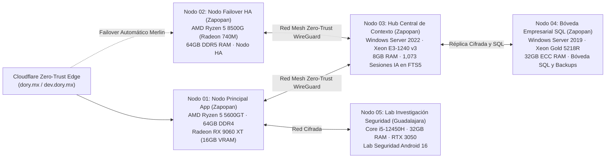

<!-- BARRA DE IDIOMA Y PORTAFOLIO -->

  <b>🌐 Idioma:</b> <a href="./README.md"><b>English 🇺🇸</b></a> | <b>Español 🇲🇽</b>

<h1>Carlos Alberto Aceves Cabrera <kbd>@Charly-bite</kbd></h1>
<h3>Ingeniero en Ciberseguridad · Arquitecto de Sistemas de IA · Líder Full-Stack y ERP/WMS (Guadalajara / Zapopan, ZMG)</h3>

  
  
  
  
  
  
  

  <b>📍 Zona Metropolitana de Guadalajara (Guadalajara / Zapopan, Jalisco, México)</b> · <b>✉️</b> <a href="mailto:carlos.aceves6195@alumnos.udg.mx">carlos.aceves6195@alumnos.udg.mx</a> 
  <b>🟢 Disponibilidad Inmediata para Reclutadores y Equipos de Ingeniería en ZMG (Presencial · Híbrido · Remoto)</b> · Lic. en Ciberseguridad (LCIB) @ Universidad de Guadalajara (CUGDL, Código SIIAU: <code>225361954</code>)

---

## ⚡ Telemetría Ejecutiva Verificada

| Indicador | Registro Verificado | Fuente Oficial / Evidencia |
| :--- | :--- | :--- |
| **Promedio Oficial SIIAU** | **97.45 / 100** (`160 / 349` Créditos · `45.85%`) | Kardex Certificado SIIAU UDG (`225361954` · [Descargar Kardex SIIAU Original](https://dev.dory.mx/vault/siiau)) |
| **Área Básico Particular (BPO)** | **99.29 / 100** (`56 / 56` Créditos · **100% Completada**) | **14 de 20** Materias Evaluadas con **Calificación Perfecta de `100 / 100`** |
| **Huella Total de Ingeniería** | **60 Sistemas Verificados** | **49 Repositorios en GitHub** + **11 Suites de Clúster, Móvil y Producción** |
| **Impacto Industrial en ZMG** | **12 Sistemas en Producción en Zapopan** | Operando diariamente en **Química Boss S.A. de C.V.** (SAP B1, WMS, ZPL USB, ISO 9001, IDS) |
| **Clúster Híbrido Propio** | **5 Nodos · 200 GB RAM Totales** | `Xeon Gold 5218R` + `Xeon E3-1240 v3` + `Ryzen 5 8500G` + `Ryzen 5 5600GT` + `Core i5-12450H` |

---

## 🏢 Experiencia Profesional en la Zona Metropolitana de Guadalajara (ZMG)

### 1. **Química Boss S.A. de C.V.** — *Zapopan, Jalisco (ZMG) | 2024 – Presente*
**Ingeniero Líder de Desarrollo Full-Stack, ERP/WMS y Seguridad de Infraestructura**
- **QB-SGA y QB-WMS:** Diseñé y desplegué los sistemas de gestión de almacén y trazabilidad de lotes químicos sincronizados con **SAP Business One** (`Lote`, `Pedimento Aduanal`, control de caducidades FIFO/FEFO y escaneo móvil).
- **Zebra ZPL Native USB Studio:** Desarrollé un motor de impresión térmica industrial en Python usando la API nativa Win32 (`CreateFileW`) para enviar comandos `ZPL II` directo por USB sin pasar por el spooler de Windows (0 ms de latencia en etiquetado de tambores químicos).
- **QB-SAO y QB-Panel ISO 9001:2026:** Automaticé la emisión de Certificados de Análisis de Laboratorio (`CoA`) y construí el panel de auditoría y mantenimiento preventivo TI para 5 servidores y estaciones de trabajo.
- **Visores Ejecutivos BI y Data Lake Químico:** Desarrollé *Visor Compras v8.1*, *QB-Ventas v8.2*, *Visor Contabilidad*, *QB-CCA* (extractor automático de recibos industriales CFE tarifa `GDMTH` en PDF) y *QB-IDS* (colector syslog FortiGate con globo 3D de amenazas).

### 2. **Dory Zero-Trust Security & AI (`dory.mx` / `dev.dory.mx`)** — *Guadalajara, Jalisco | 2025 – Presente*
**Fundador, Investigador en Ciberseguridad y Arquitecto de Sistemas Distribuidos**
- **Motor Antiphishing con IA Explicable (`Dory.lat` / `XIA-Phishing`):** Entrenamiento y calibración sobre +82,000 correos con atribución explicable en vivo mediante **SHAP** y **LIME**, integrado con playbooks de respuesta a incidentes NIST SP 800-61.
- **Anonimizador Mexicano PII / ARCO / LFPDPPP:** Firewall de privacidad en tiempo real y **Extensión Chrome MV3 (`v0.3.0`)** que enmascara `RFC`, `CURP`, `CLABE`, `NSS`, tarjetas y secretos antes de enviar prompts a ChatGPT, Claude, Gemini, Copilot o Perplexity.
- **Clúster Híbrido de 5 Nodos y Merlin Watchdog:** Orquestación de alta disponibilidad (`merlin-powershell`) y **Hub Central de Memoria Persistente** indexando **1,073 sesiones técnicas** (`43,156` bloques en SQLite FTS5 + grafo Engram).

### 3. **Consultoría Full-Stack, E-Commerce y Seguridad Móvil Android 16 (ZMG)** — *Guadalajara / Zapopan | 2025 – Presente*
- **Lunoto (E-Commerce Guadalajara):** Tienda en línea full-stack y personalizador visual interactivo en HTML5 Canvas con cotización dinámica.
- **Dra. Odette Noyola (`draodettenoyola.com` — Chapalita, Guadalajara):** Plataforma médica estética en producción con datos estructurados Schema.org `MedicalBusiness` y embudo de conversión por WhatsApp.
- **GovTech y Auditoría de Transporte Urbano:** Desarrollo de *Visor Web MunTal Requisiciones* (portal de compras municipales) y auditoría de seguridad a infraestructura de transporte urbano (*SITEUR* Guadalajara).
- **Seguridad en Android 16 y FinTech:** Desarrollo de *AgyAndroidAuditor* (app nativa Kotlin Jetpack Compose con binario ARM64 `agy` + servidor MCP local embebido en Android 16) y *FinanzasMobile* (simulador quincenal mexicano de `ISR`, `IMSS` y portafolio cuantitativo).

---

## 📌 Repositorios Públicos Destacados (6 Tarjetas Principales)

<table>
  <tr>
    <td width="50%" valign="top">
      <b>01 · 🛡️ <a href="https://github.com/Charly-bite/Dory.lat">Dory.lat</a></b> 
      <code>Python</code> · <code>SHAP / LIME</code> · <code>Chrome MV3 v0.3.0</code> 
      Plataforma de Seguridad IA Zero-Trust (<code>dory.mx</code>), Motor Antiphishing XAI (+82K correos) y Anonimizador PII/ARCO mexicano.
    </td>
    <td width="50%" valign="top">
      <b>02 · 🧠 <a href="https://github.com/Charly-bite/Porygon-Cyber-IDS-Wallpaper">Porygon-Cyber-IDS-Wallpaper</a></b> 
      <code>C#</code> · <code>.NET</code> · <code>3D Spiking Neural Network</code> · <code>OpenGL</code> 
      Sistema de Detección de Intrusiones (IDS) con Redes Neuronales de Impulsos (SNN) en 3D que visualiza entropía de paquetes en tiempo real.
    </td>
  </tr>
  <tr>
    <td width="50%" valign="top">
      <b>03 · 🏭 <a href="https://github.com/Charly-bite/QB-SGA">QB-SGA</a></b> 
      <code>JavaScript</code> · <code>Node.js</code> · <code>SAP Business One</code> · <code>SQL</code> 
      Sistema Empresarial de Gestión de Almacén y Trazabilidad de Lotes Químicos sincronizado con SAP Business One en Química Boss (Zapopan).
    </td>
    <td width="50%" valign="top">
      <b>04 · 🏷️ <a href="https://github.com/Charly-bite/zebra">zebra</a></b> 
      <code>Python</code> · <code>Win32 CreateFileW</code> · <code>ZPL II</code> · <code>Flask</code> 
      Estudio de Etiquetado Térmico Industrial por USB nativo sin pasar por la cola de impresión de Windows (0 ms de latencia).
    </td>
  </tr>
  <tr>
    <td width="50%" valign="top">
      <b>05 · 🚆 <a href="https://github.com/Charly-bite/SITEUR">SITEUR</a></b> 
      <code>Auditoría de Ciberseguridad</code> · <code>OWASP</code> · <code>Infraestructura Crítica</code> 
      Dossier de Auditoría de Seguridad, Análisis de Superficie de Ataque y Remediación para Transporte Urbano de Guadalajara (SITEUR).
    </td>
    <td width="50%" valign="top">
      <b>06 · ⚡ <a href="https://github.com/Charly-bite/hcp-fuzzing">hcp-fuzzing</a></b> 
      <code>Go</code> · <code>Slurm HPC</code> · <code>Coverage-Guided Fuzzing</code> 
      Suite Distribuida de Fuzzing y Descubrimiento de Vulnerabilidades en Clústeres de Alto Rendimiento (HPC Slurm).
    </td>
  </tr>
</table>

---

## 🏆 Top 18 Desarrollos de Mayor Impacto (En vivo en [dev.dory.mx](https://dev.dory.mx/dev))

| Rango | Sistema / Repositorio | Stack Principal | Arquitectura Verificada e Impacto en Producción |
| :---: | :--- | :--- | :--- |
| **#1** | [**Dory.lat**](https://github.com/Charly-bite/Dory.lat) | `Python` `Flask` `SHAP` `LIME` `Chrome MV3` | Plataforma Zero-Trust (`dory.mx`), Detector Antiphishing XAI (+82K correos), Anonimizador PII/ARCO mexicano y Extensión Chrome `v0.3.0`. |
| **#2** | [**fuzzing-slurm-framework**](https://github.com/Charly-bite/fuzzing-slurm-framework) | `Go` `Slurm HPC` `Docker` `REST API` | Orquestador distribuido de Fuzzing y descubrimiento de vulnerabilidades sobre clústeres HPC Slurm. |
| **#3** | [**sentinel-go**](https://github.com/Charly-bite/sentinel-go) | `Rust` `Hickory DNS` `AES-GCM` `mTLS` | Agente de telemetría DNS cifrada de alta concurrencia en Rust con Tokio y fragmentación autenticada AES-GCM. |
| **#4** | [**SplunkSim**](https://github.com/Charly-bite/SplunkSim) | `TypeScript` `React` `Motor SPL` `MITRE` | Simulador interactivo SIEM y motor de consultas SPL para Threat Hunting con escenarios MITRE ATT&CK. |
| **#5** | [**AgyAndroidAuditor**](https://github.com/Charly-bite/AgyAndroidAuditor) | `Kotlin` `Android 16` `ARM64` `Embedded MCP` | Auditor de seguridad nativo en Android 16 (POCO X7 Pro) con binario `agy` `arm64-v8a` embebido y servidor MCP local. |
| **#6** | [**swarm-ai-orchestrator**](https://github.com/Charly-bite/swarm-ai-orchestrator) | `Python` `FastAPI` `AsyncIO` `SSE` | Orquestador de enjambre multi-agente coordinando +10 agentes autónomos sobre el clúster híbrido de 5 nodos. |
| **#7** | [**Persistent-Memory**](https://github.com/Charly-bite/Persistent-Memory) | `Python` `MCP` `SQLite FTS5` `Engram` | Servidor MCP de memoria persistente multiequipo (**1,073 conversaciones** y **43,156 bloques** indexados en Tailscale). |
| **#8** | [**QB-SGA**](https://github.com/Charly-bite/QB-SGA) | `JavaScript` `Node.js` `SAP B1` `SQL` | Sistema de Gestión de Almacén y trazabilidad química sincronizado con **SAP Business One** en Química Boss (Zapopan). |
| **#9** | [**zebra**](https://github.com/Charly-bite/zebra) | `Python` `Win32 API` `ZPL II` `Flask` | Estudio de etiquetado térmico industrial vía USB nativo (`CreateFileW`) sin cola de impresión de Windows. |
| **#10** | [**Visor_Web_QuimicaBoss_Compras**](https://github.com/Charly-bite/Visor_Web_QuimicaBoss_Compras) | `Python` `Chart.js` `Pandas` `ERP` | Plataforma de Inteligencia de Compras v8.1 para análisis de materias primas químicas, tiempos de entrega y divisas. |
| **#11** | [**QB-Ventas**](https://github.com/Charly-bite/QB-Ventas) | `JavaScript` `Python` `BI` `Export` | Plataforma de Inteligencia Comercial y Márgenes v8.2 para seguimiento de cartera industrial B2B. |
| **#12** | [**Porygon-Cyber-IDS-Wallpaper**](https://github.com/Charly-bite/Porygon-Cyber-IDS-Wallpaper) | `C#` `.NET` `3D SNN` `OpenGL` | Sistema de Detección de Intrusiones (IDS) con Redes Neuronales de Impulsos (SNN) en 3D en tiempo real. |
| **#13** | [**YaraGenerator**](https://github.com/Charly-bite/YaraGenerator) | `Python` `PEfile` `YARA` `Entropía` | Sintetizador automático de firmas de malware y reglas YARA a partir de binarios PE/ELF. |
| **#14** | [**Info**](https://github.com/Charly-bite/Info) | `JavaScript` `LFPDPPP` `ARCO` `Forense` | Plataforma interactiva de concientización sobre huella digital y protección de datos personales en México. |
| **#15** | [**Lunoto**](https://github.com/Charly-bite/Lunoto) | `JavaScript` `Canvas` `E-Commerce` | E-Commerce full-stack en Guadalajara con personalizador visual interactivo de productos en tiempo real. |
| **#16** | [**MeteorMadness**](https://github.com/Charly-bite/MeteorMadness) | `JavaScript` `Three.js` `WebGL` `NASA API` | Simulador 3D de mecánica orbital de asteroides NEO de la NASA y física de impacto cinético. |
| **#17** | [**BecaFinder**](https://github.com/Charly-bite/BecaFinder) | `TypeScript` `React` `Vite` `Matching` | Motor de búsqueda y emparejamiento de becas internacionales y estancias de investigación. |
| **#18** | [**merlin-powershell**](https://github.com/Charly-bite/merlin-powershell) | `PowerShell` `Cloudflare` `Tailscale` | Demonio de autorrecuperación (Self-Healing) y failover automático para el clúster de 5 nodos. |

---

## 🖥️ Topología Verificada del Clúster Híbrido de 5 Nodos (`200 GB RAM Totales`)

---

## 🎓 Kardex Oficial Certificado — Universidad de Guadalajara (CUGDL)

- **Carrera:** Licenciatura en Ciberseguridad (`LCIB`) · **Código de Estudiante SIIAU:** `225361954`
- **Promedio Oficial Certificado en SIIAU:** **`97.45 / 100`** (`160 / 349` Créditos Aprobados = `45.85%` · Vigente en 4.º Semestre `2026-B`)
- **Área Básico Particular Obligatoria (BPO):** **`56 / 56` Créditos (`100%` Completada)** con promedio de **`99.29 / 100`**
- **14 de 20 Materias Evaluadas con Calificación Perfecta de `100 / 100`:**
  - `V2261` Hacking Ético (Fundamentos) (`100`) · `V2262` Sistemas Operativos Distribuidos (`100`) · `V2214` Programación II (`100`) · `V2216` Bases de Datos (`100`)
  - `V2213` Programación I (`100`) · `V2212` Introducción a la Ciencia de Datos (`100`) · `V2211` Álgebra Lineal (`100`) · `V2239` Probabilidad y Estadística I (`100`)
  - `I0869` Matemáticas II (`100`) · `V2179` Ética y Responsabilidad Social (`100`) · `V2168` Innovación Tecnológica (`100`) · `V2167` Pensamiento Crítico (`100`)
  - `V2169` Inteligencia Colectiva (`100`) · `V2171` Gestión Socioemocional y Cognitivo (`100`) · `V2265` La Nube Computacional y la Ciberseguridad (`98`)

---

  <b>🔗 Explora las Aplicaciones en Vivo, el IDE de Código Fuente y los PDFs Oficiales en:</b> <a href="https://dev.dory.mx"><b>https://dev.dory.mx</b></a>

