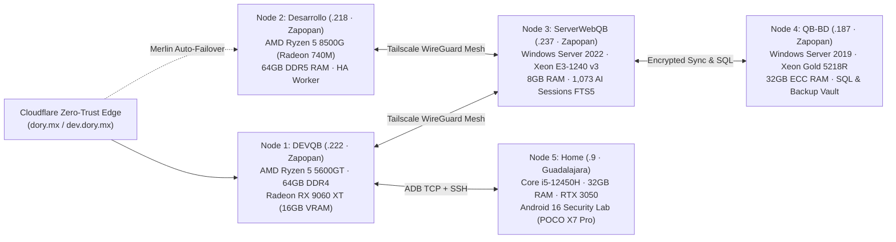

<!-- LANGUAGE & PORTFOLIO BAR -->

  <b>🌐 Language:</b> <b>English</b> | <a href="./README-es.md"><b>Español 🇲🇽</b></a>

<h1>Carlos Alberto Aceves Cabrera <kbd>@Charly-bite</kbd></h1>
<h3>Cybersecurity Engineer · AI Systems Architect · Full-Stack &amp; ERP Lead (Guadalajara / Zapopan, ZMG)</h3>

  
  
  
  
  
  
  

  <b>📍 Zona Metropolitana de Guadalajara (Guadalajara / Zapopan, Jalisco, México)</b> · <b>📞 WhatsApp / Tel:</b> <code>+52 33 1388 5654</code> · <b>✉️</b> <a href="mailto:carlos.aceves6195@alumnos.udg.mx">carlos.aceves6195@alumnos.udg.mx</a> 
  <b>🟢 Available for Technical Recruiters &amp; Engineering Teams in ZMG (On-Site · Hybrid · Remote)</b> · B.S. in Cybersecurity (LCIB) @ Universidad de Guadalajara (CUGDL, ID: <code>225361954</code>)

---

## ⚡ Verified Executive Telemetry

| Metric | Verified Record | Official Source / Evidence |
| :--- | :--- | :--- |
| **Official SIIAU GPA** | **97.45 / 100** (`160 / 349` Credits · `45.85%`) | Certified SIIAU UDG Kardex (`225361954` · [Download Original SIIAU PDF](https://dev.dory.mx/vault/siiau)) |
| **Core CS & Math Area (BPO)** | **99.29 / 100** (`56 / 56` Credits · **100% Complete**) | **14 of 20** Graded University Courses with a **Perfect `100 / 100`** |
| **Production Engineering Footprint** | **60 Verified Systems** | **49 GitHub Repositories** + **11 Cluster, Mobile & Enterprise Suites** |
| **ZMG Industrial Track Record** | **12 Production Systems in Zapopan** | Operating daily at **Química Boss S.A. de C.V.** (SAP B1, WMS, ZPL USB, ISO 9001, IDS) |
| **Self-Hosted Hybrid Cluster** | **5 Nodes · 200 GB Total RAM** | `Xeon Gold 5218R` + `Xeon E3-1240 v3` + `Ryzen 5 8500G` + `Ryzen 5 5600GT` + `Core i5-12450H` |

---

## 🏢 Production Experience in Zona Metropolitana de Guadalajara (ZMG)

### 1. **Química Boss S.A. de C.V.** — *Zapopan, Jalisco (Col. El Briseño) | 2024 – Present*
**Lead Full-Stack, ERP/WMS & Infrastructure Security Engineer**
- **QB-SGA & QB-WMS (`:5000`):** Architected warehouse and chemical drum traceability platforms integrated with **SAP Business One** (`Lote`, `Pedimento Aduanal`, FIFO/FEFO expiration control, and mobile scanner UI).
- **Zebra ZPL Native USB Studio (`:5050`):** Engineered a custom Python + Win32 `CreateFileW` raw USB driver bypassing the Windows print spooler for zero-latency industrial thermal drum labels (`ZPL II`) and dynamic QR codes.
- **QB-SAO & QB-Panel ISO 9001:2026 (`:8080`):** Automated chemical laboratory Certificates of Analysis (`CoA`) and built the IT infrastructure audit & preventive maintenance control system across 5 production servers/workstations.
- **Executive BI Visors & Chemical Data Lake:** Delivered *Visor Compras v8.1* (multivariate supplier pricing & lead-time analytics), *QB-Ventas v8.2*, *Visor Contabilidad*, *QB-CCA* (automated CFE industrial tariff `GDMTH` PDF parser), and *QB-IDS* (FortiGate syslog collector + 3D threat globe).

### 2. **Dory Zero-Trust Security & AI (`dory.mx` / `dev.dory.mx`)** — *Guadalajara, Jalisco | 2025 – Present*
**Founder, Security Researcher & Distributed Systems Architect**
- **Explainable AI Phishing Engine (`Dory.lat` / `XIA-Phishing`):** Calibrated ensemble classifiers on 82,000+ emails with real-time **SHAP** and **LIME** token-level attribution and automated NIST SP 800-61 incident response playbooks.
- **Mexican PII / ARCO / LFPDPPP Anonymizer:** Shipped a zero-latency privacy firewall and **Chrome MV3 Extension (`v0.3.0`)** that detects and redacts Mexican `RFC`, `CURP`, `CLABE`, `NSS`, and API keys before prompts reach external LLMs (ChatGPT, Claude, Gemini, Copilot, Perplexity).
- **5-Node Hybrid Cluster & Merlin Watchdog:** Engineered self-healing reverse-proxy failover (`merlin-powershell`) and the **Persistent-Memory Hub** on `ServerWebQB (.237)` indexing **1,073 AI engineering sessions** (`43,156` FTS5 blocks + Engram knowledge graph).

### 3. **Full-Stack, E-Commerce & Android 16 Security Consulting (ZMG)** — *Guadalajara / Zapopan | 2025 – Present*
- **Lunoto (Guadalajara E-Commerce):** Full-stack custom apparel store and interactive HTML5 canvas product builder with real-time pricing and order fulfillment.
- **Dra. Odette Noyola (`draodettenoyola.com` — Chapalita, Guadalajara):** High-conversion medical aesthetics platform with Schema.org `MedicalBusiness` structured data and direct WhatsApp consultation flows.
- **GovTech & Urban Transit Security:** Developed *Visor Web MunTal Requisiciones* (municipal procurement transparency portal) and executed the *SITEUR* Guadalajara urban rail vulnerability assessment.
- **Android 16 Security & FinTech:** Built *AgyAndroidAuditor* (Kotlin Jetpack Compose app embedding native ARM64 `agy` binary + local MCP server `:8765` on POCO X7 Pro) and *FinanzasMobile* (bi-weekly Mexican `ISR` / `IMSS` financial simulator).

---

## 🏆 Top 18 High-Impact Flagship Systems (Live on [dev.dory.mx](https://dev.dory.mx/dev))

| Rank | System / Repository | Stack | Verified Architecture & Production Impact |
| :---: | :--- | :--- | :--- |
| **#1** | [**Dory.lat**](https://github.com/Charly-bite/Dory.lat) | `Python` `Flask` `SHAP` `LIME` `Chrome MV3` | Zero-Trust AI Security Platform (`dory.mx`), Explainable AI Phishing Detector (82K+ emails), Mexican LFPDPPP/ARCO PII Anonymizer & Chrome Extension `v0.3.0`. |
| **#2** | [**fuzzing-slurm-framework**](https://github.com/Charly-bite/fuzzing-slurm-framework) | `Go` `Slurm HPC` `Docker` `REST API` | Distributed Vulnerability Discovery & Fuzzing Orchestrator on Slurm HPC clusters with automated crash deduplication and dynamic seed scheduling. |
| **#3** | [**sentinel-go**](https://github.com/Charly-bite/sentinel-go) | `Rust` `Hickory DNS` `AES-GCM` `mTLS` | High-concurrency encrypted DNS telemetry & C2 research agent using asynchronous Tokio tasks and authenticated AES-GCM payload chunking. |
| **#4** | [**SplunkSim**](https://github.com/Charly-bite/SplunkSim) | `TypeScript` `React` `SPL Engine` `MITRE` | Interactive SIEM & SPL Threat Hunting Simulator with real-time query execution and MITRE ATT&CK adversary emulation scenarios. |
| **#5** | [**AgyAndroidAuditor**](https://github.com/Charly-bite/AgyAndroidAuditor) | `Kotlin` `Android 16` `ARM64` `MCP :8765` | Native Android 16 Security Auditor on POCO X7 Pro embedding compiled `agy` `arm64-v8a` binary + local Model Context Protocol (MCP) server. |
| **#6** | [**swarm-ai-orchestrator**](https://github.com/Charly-bite/swarm-ai-orchestrator) | `Python` `FastAPI` `AsyncIO` `SSE` | Distributed Multi-Agent AI Swarm Orchestrator coordinating 10+ autonomous specialized agents across the 5-node hybrid cluster. |
| **#7** | [**Persistent-Memory**](https://github.com/Charly-bite/Persistent-Memory) | `Python` `MCP` `SQLite FTS5` `Engram` | Cross-Host AI Context & Memory MCP Server synchronizing **1,073 conversations** and **43,156 searchable blocks** across 5 Tailscale nodes. |
| **#8** | [**QB-SGA**](https://github.com/Charly-bite/QB-SGA) | `JavaScript` `Node.js` `SAP B1` `SQL` | Industrial Warehouse & Chemical Traceability System synced with **SAP Business One** in production at Química Boss (Zapopan). |
| **#9** | [**zebra**](https://github.com/Charly-bite/zebra) | `Python` `Win32 API` `ZPL II` `Flask` | Native USB Industrial Thermal Label Studio bypassing Windows spooler via `CreateFileW` for zero-latency chemical drum labeling. |
| **#10** | [**Visor_Web_QuimicaBoss_Compras**](https://github.com/Charly-bite/Visor_Web_QuimicaBoss_Compras) | `Python` `Chart.js` `Pandas` `ERP` | Executive Purchasing BI Platform v8.1 analyzing chemical raw material costs, supplier lead times, and multi-currency variance. |
| **#11** | [**QB-Ventas**](https://github.com/Charly-bite/QB-Ventas) | `JavaScript` `Python` `BI` `Export` | Commercial Sales Intelligence & Margin Analytics v8.2 tracking B2B industrial client retention and salesperson quotas. |
| **#12** | [**Porygon-Cyber-IDS-Wallpaper**](https://github.com/Charly-bite/Porygon-Cyber-IDS-Wallpaper) | `C#` `.NET` `3D SNN` `OpenGL` | 3D Spiking Neural Network (SNN) Intrusion Detection System visualizing live network packet entropy as synaptic firing topologies. |
| **#13** | [**YaraGenerator**](https://github.com/Charly-bite/YaraGenerator) | `Python` `PEefile` `YARA` `Entropy` | Automated Malware Signature & YARA Rule Synthesizer extracting high-entropy opcodes and PE header anomalies. |
| **#14** | [**Info**](https://github.com/Charly-bite/Info) | `JavaScript` `LFPDPPP` `ARCO` `Forensics` | Interactive Digital Footprint, Browser Telemetry & Mexican Data Privacy (LFPDPPP / ARCO) Awareness Platform. |
| **#15** | [**Lunoto**](https://github.com/Charly-bite/Lunoto) | `JavaScript` `Canvas` `E-Commerce` | Guadalajara Full-Stack E-Commerce & Interactive Visual Product Customizer with live mockup rendering. |
| **#16** | [**MeteorMadness**](https://github.com/Charly-bite/MeteorMadness) | `JavaScript` `Three.js` `WebGL` `NASA API` | 3D NASA NEO Asteroid Orbital Mechanics & Kinetic Impact Physics Simulator (`E = ½mv²` crater & thermal blast modeling). |
| **#17** | [**BecaFinder**](https://github.com/Charly-bite/BecaFinder) | `TypeScript` `React` `Vite` `Matching` | International Academic Scholarship & Research Fellowship Matching Engine (DAAD, Max Planck, Fulbright, Chevening). |
| **#18** | [**merlin-powershell**](https://github.com/Charly-bite/merlin-powershell) | `PowerShell` `Cloudflare` `Tailscale` | Self-Healing Multi-Node Reverse Proxy & High-Availability Failover Daemon for the 5-node cluster. |

---

## 🖥️ Verified 5-Node Hybrid Cluster Topology (`200 GB Total RAM`)

---

## 🗂️ Complete 60-System Engineering Inventory (49 GitHub Repos + 11 Cluster Systems)

Every repository below is verified against `github.com/Charly-bite` and can be explored live (with interactive sandbox + full source tree IDE) at **[https://dev.dory.mx/dev](https://dev.dory.mx/dev)**:

<b>🛡️ 1. Offensive Security, Threat Hunting, Cryptography & Privacy (13 Systems)</b>

1. **[Dory.lat](https://github.com/Charly-bite/Dory.lat)** — Zero-Trust AI Security Platform (`dory.mx`), SHAP/LIME Phishing Engine & Chrome MV3 Extension `v0.3.0`.
2. **[fuzzing-slurm-framework](https://github.com/Charly-bite/fuzzing-slurm-framework)** — Distributed Go Fuzzing Orchestrator on Slurm HPC Clusters.
3. **[sentinel-go](https://github.com/Charly-bite/sentinel-go)** — Rust Hickory DNS Encrypted C2 & Telemetry Research Agent.
4. **[SplunkSim](https://github.com/Charly-bite/SplunkSim)** *(Private)* — Interactive SIEM & SPL Threat Hunting Simulator.
5. **[Porygon-Cyber-IDS-Wallpaper](https://github.com/Charly-bite/Porygon-Cyber-IDS-Wallpaper)** — C# 3D Spiking Neural Network (SNN) Live Intrusion Detection Engine.
6. **[YaraGenerator](https://github.com/Charly-bite/YaraGenerator)** — Automated Malware Signature & YARA Rule Synthesizer.
7. **[XIA-Phishing](https://github.com/Charly-bite/XIA-Phishing)** — Explainable AI (XAI) Phishing Feature Attribution Research Pipeline.
8. **[Info](https://github.com/Charly-bite/Info)** — Interactive Digital Footprint & Mexican Data Privacy (LFPDPPP / ARCO) Story.
9. **[huella-digital-vault](https://github.com/Charly-bite/huella-digital-vault)** — Cryptographic Digital Footprint & Browser Fingerprint Vault.
10. **[IDS-FALLBACK](https://github.com/Charly-bite/IDS-FALLBACK)** — Resilient Intrusion Detection Fallback & Packet Capture Watchdog.
11. **[UAC](https://github.com/Charly-bite/UAC)** — Rust Windows User Account Control (UAC) & Token Privilege Research Utility.
12. **[SITEUR](https://github.com/Charly-bite/SITEUR)** — Guadalajara Urban Rail (SITEUR) Infrastructure Security Audit Dossier.
13. **[papirolas-ciberheroes-2026](https://github.com/Charly-bite/papirolas-ciberheroes-2026)** — Gamified Cybersecurity Defense & Youth Digital Safety Simulator (Papirolas GDL).

<b>🤖 2. Multi-Agent AI, Distributed Inference & Voice/Media Systems (10 Systems)</b>

14. **[swarm-ai-orchestrator](https://github.com/Charly-bite/swarm-ai-orchestrator)** — Multi-Agent AI Swarm Coordinator & Task Router (`:9090`).
15. **[Persistent-Memory](https://github.com/Charly-bite/Persistent-Memory)** *(Private)* — Cross-Host MCP Memory Server (`1,073` conversations, `43,156` FTS5 blocks + Engram).
16. **[Cluster-IA-Distribuido](https://github.com/Charly-bite/Cluster-IA-Distribuido)** — Distributed GGML RPC & Tensor-Split LLM Inference Cluster.
17. **[swarm-un-image](https://github.com/Charly-bite/swarm-un-image)** — Multi-Agent Visual Synthesis & Computer Vision Pipeline.
18. **[voz](https://github.com/Charly-bite/voz)** — Local CUDA `whisper.cpp` Push-to-Talk Voice Dictation Daemon.
19. **[videonarrador](https://github.com/Charly-bite/videonarrador)** — Automated AI Video Narration, Script Synthesis & FFmpeg Rendering Pipeline.
20. **[prompeneitor](https://github.com/Charly-bite/prompeneitor)** — Structured PTCF XML Prompt Engineering & Evaluation Workbench.
21. **Cluster-Salud-Monitor (:8501)** *(Cluster App)* — Real-Time 5-Node GPU/CPU/VRAM/Tailscale Health Telemetry Dashboard.
22. **Swarm-10-Agents-Runtime (:9090)** *(Cluster App)* — Autonomous 10-Agent Specialized Code & Security Review Runtime.
23. **Antigravity-Sync-Hub** *(Cluster App)* — Automated Multi-Host Context & SQLite FTS5 Synchronization Engine (`ServerWebQB .237` + `QB-BD .187`).

<b>🏭 3. Enterprise ERP/WMS, SAP B1 & ZMG Production Systems (20 Systems)</b>

24. **[QB-SGA](https://github.com/Charly-bite/QB-SGA)** *(Private)* — Warehouse & Chemical Lot Traceability System synced with SAP Business One.
25. **[qb-wms](https://github.com/Charly-bite/qb-wms)** *(Private)* — Industrial Warehouse Management System & Barcode Dispatch Engine (`:5000`).
26. **[SGA_v1.0](https://github.com/Charly-bite/SGA_v1.0)** — Modular Open Warehouse Management Architecture (`v1.0`).
27. **[QB-SAO](https://github.com/Charly-bite/QB-SAO)** *(Private)* — Automated Chemical Laboratory Certificates of Analysis (`CoA`) & Order Tracking.
28. **[QB-Bitacora](https://github.com/Charly-bite/QB-Bitacora)** *(Private)* — Industrial Plant Operations & Shift Audit Logbook.
29. **[zebra](https://github.com/Charly-bite/zebra)** *(Private)* — Native Win32 USB ZPL II Industrial Thermal Label Studio (`:5050`).
30. **[Visor_Web_QuimicaBoss_Compras](https://github.com/Charly-bite/Visor_Web_QuimicaBoss_Compras)** *(Private)* — Executive Purchasing Intelligence Platform v8.1.
31. **[QB-Ventas](https://github.com/Charly-bite/QB-Ventas)** *(Private)* — Commercial Sales & Margin Intelligence Platform v8.2.
32. **[Visor_Web_QuimicaBoss_Contabilidad](https://github.com/Charly-bite/Visor_Web_QuimicaBoss_Contabilidad)** *(Private)* — Financial Ledger, Fiscal Reconciliation & Accounting Visor.
33. **[QB-Panel](https://github.com/Charly-bite/QB-Panel)** *(Private)* — ISO 9001:2026 IT Infrastructure Audit & Preventive Maintenance Control Panel (`:8080`).
34. **[QB-CCA](https://github.com/Charly-bite/QB-CCA)** *(Private)* — Automated CFE Industrial Tariff (`GDMTH`) PDF Parser & Energy Cost Analyzer.
35. **[Promedio_Fletes](https://github.com/Charly-bite/Promedio_Fletes)** *(Private)* — Chemical Freight Cost & Logistics Route Optimization Engine.
36. **[QB-IDS](https://github.com/Charly-bite/QB-IDS)** *(Private)* — Corporate Network Intrusion Detection & FortiGate Syslog Telemetry Collector.
37. **[qb-network](https://github.com/Charly-bite/qb-network)** *(Private)* — Corporate VLAN, Subnet & Switch Port Topology Mapper.
38. **[New_page](https://github.com/Charly-bite/New_page)** *(Private)* — Corporate Digital Portal for Química Boss (`quimicaboss.com.mx`).
39. **[Lunoto](https://github.com/Charly-bite/Lunoto)** *(Private)* — Guadalajara E-Commerce & Interactive Visual Apparel Customizer.
40. **[Visor_Web_MunTal_Requisiciones](https://github.com/Charly-bite/Visor_Web_MunTal_Requisiciones)** *(Private)* — Municipal Government Requisitions & Procurement Portal.
41. **Datalake-Quimico** *(Cluster Suite)* — Unified Industrial Chemical Data Lake (SAP B1 + Compras + Ventas + Fletes + CFE).
42. **Dra-Odette-Web (`draodettenoyola.com`)** *(Production Web)* — Chapalita (Guadalajara) Medical Aesthetics Platform with Schema.org GEO.
43. **Credenciales-Corporativas-QR** *(Cluster Tool)* — Automated PVC Employee Badge & VCard QR Generator for Química Boss.

<b>📱 4. Android 16 Native, Infrastructure Automation & Academic/Sci-Comp (17 Systems)</b>

44. **[AgyAndroidAuditor](https://github.com/Charly-bite/AgyAndroidAuditor)** *(Private)* — Kotlin Android 16 Security Auditor + Native ARM64 `agy` + MCP Server `:8765`.
45. **[AndroidControl](https://github.com/Charly-bite/AndroidControl)** — Low-Latency ADB & Scrcpy Android Device Automation Toolkit.
46. **[merlin-powershell](https://github.com/Charly-bite/merlin-powershell)** — Self-Healing Multi-Node Reverse Proxy & Watchdog Orchestrator.
47. **[MeteorMadness](https://github.com/Charly-bite/MeteorMadness)** — 3D WebGL NASA Asteroid Orbital & Impact Physics Simulator.
48. **[BecaFinder](https://github.com/Charly-bite/BecaFinder)** *(Private)* — International Scholarship & Research Fellowship Matching Platform.
49. **[Buscador_Academico](https://github.com/Charly-bite/Buscador_Academico)** *(Private)* — Official SIIAU UDG Curriculum (`LCIB`), Kardex & Scholarship Tracker.
50. **[Tareas](https://github.com/Charly-bite/Tareas)** — University Cybersecurity Coursework & LaTeX Research Automation (`CUGDL`).
51. **[Ciatej](https://github.com/Charly-bite/Ciatej)** — Scientific Research Data Processing & Bioinformatics Utility (CIATEJ GDL).
52. **[Caminos_de_Michoacan](https://github.com/Charly-bite/Caminos_de_Michoacan)** — Geospatial Route & Regional Logistics Visualization Project.
53. **[Hause](https://github.com/Charly-bite/Hause)** — Smart Home IoT Telemetry & Automation Prototype.
54. **[Loom-video](https://github.com/Charly-bite/Loom-video)** — Asynchronous Screen Recording & Engineering Walkthrough Tool.
55. **[Charly-bite](https://github.com/Charly-bite/Charly-bite)** — Executive Bilingual Engineering Dossier & 60-Project Architecture Index.
56. **FinanzasMobile + Quant Simulator (:8502)** *(Mobile + Web)* — Native Android Kotlin App + Mexican `ISR`/`IMSS` Bi-Weekly Financial Simulator.
57. **POCO-Scrcpy-Studio** *(Cluster Tool)* — Hardware-Accelerated Android 16 Screen Mirroring & Input Injection Studio.
58. **RouterOS-Network-Manager (:8085)** *(Cluster App)* — MikroTik RouterOS Bandwidth, VLAN & Firewall Policy Controller.
59. **Simulador-Financiero-Quant (:8502)** *(Cluster App)* — Monte Carlo & Fixed-Income Yield Curve Portfolio Simulator.
60. **Academic-LaTeX-Auditor-Suite** *(Cluster Tool)* — Automated CUGDL Rubric Verification & TeX Live 2026 PDF Compilation Pipeline.

---

## 🎓 Certified Academic Record — Universidad de Guadalajara (CUGDL)

- **Degree:** B.S. in Cybersecurity (*Licenciatura en Ciberseguridad — LCIB*) · **SIIAU Student Code:** `225361954`
- **Certified SIIAU GPA:** **`97.45 / 100`** (`160 / 349` Credits Completed = `45.85%` · Active in 4th Semester `2026-B`)
- **Básico Particular Obligatoria (BPO) Area:** **`56 / 56` Credits (`100%` Completed)** with **`99.29 / 100` GPA**
- **14 of 20 Graded Courses with a Perfect `100 / 100`:**
  - `V2261` Hacking Ético (Fundamentos) (`100`) · `V2262` Sistemas Operativos Distribuidos (`100`) · `V2214` Programación II (`100`) · `V2216` Bases de Datos (`100`)
  - `V2213` Programación I (`100`) · `V2212` Introducción a la Ciencia de Datos (`100`) · `V2211` Álgebra Lineal (`100`) · `V2239` Probabilidad y Estadística I (`100`)
  - `I0869` Matemáticas II (`100`) · `V2179` Ética y Responsabilidad Social (`100`) · `V2168` Innovación Tecnológica (`100`) · `V2167` Pensamiento Crítico (`100`)
  - `V2169` Inteligencia Colectiva (`100`) · `V2171` Gestión Socioemocional y Cognitivo (`100`) · `V2265` La Nube Computacional y la Ciberseguridad (`98`)

---

  <b>🔗 Explore Live Sandboxes, Source Trees & Official PDFs:</b> <a href="https://dev.dory.mx"><b>https://dev.dory.mx</b></a>

